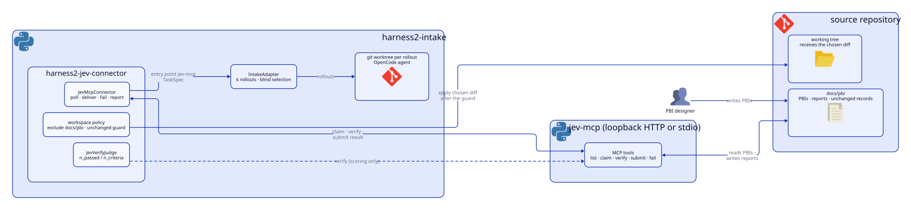
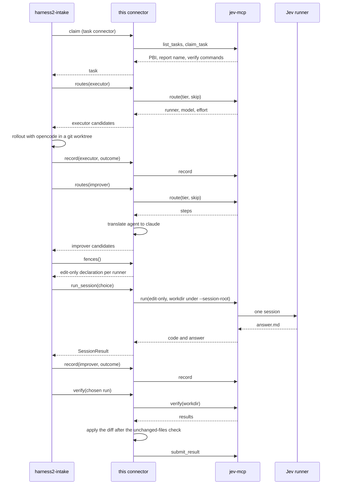

[English](README.md) | 日本語

# harness2-jev-connector

## 概要

harness2-jev-connector は、[harness2](https://github.com/reeschan/harness2) の `harness2-intake` のための
タスクコネクターです。jev-mcp に積まれた PBI を claim します。harness2 はロールアウトごとに git worktree
を作り、そこで PBI を実行します。コネクターは選ばれた実行の diff だけを取り、ソースの触らない範囲の確認
（`docs/pbi/tools/unchanged.py`）を通したあと、ソースのリポジトリに当てます。そして検証の結果と詳細を
`submit_result` で返します。

タスクのコネクターに加えて、モデルのコネクター `jev` も用意しています。harness2-intake は
`--model-connector jev` で読み込み、候補のモデル・柵の申告・試行の記録を、タスクのコネクターと
同じ jev-mcp から受け取ります。

<picture>
  <source media="(prefers-color-scheme: dark)" srcset="assets/architecture/architecture-dark.svg">
  
</picture>

図のソースは `assets/architecture/architecture.d2` です。arch-diagram スキルの `render.py` で描き直します。

## 必要なもの

- POSIX: Linux または macOS。Windows では WSL を使います。
- Python 3.12〜3.13。
- harness2。下のインストールで依存として入ります。
- jev-mcp: pbi-orchestration-jev スキルに入っている `jev_mcp.py` サーバー。

## インストール

```sh
pip install "harness2-jev-connector @ git+https://github.com/reeschan/harness2-jev-connector.git"
```

harness2 は依存として git から入ります。入るのは、このパッケージがテストに使ったコミットです（`pyproject.toml` を参照）。

## 使い方

jev-mcp を stdio で起動します。

```sh
python <path-to>/jev_mcp.py --root <repo> --root <work-root>
```

HTTP で起動することもできます。

```sh
python <path-to>/jev_mcp.py --http --port 7830 --root <repo> --root <work-root>
```

HTTP のエンドポイントに対して harness2-intake を実行します。

```sh
harness2-intake --connector jev-mcp \
  --connector-opt url=http://127.0.0.1:7830/mcp \
  --repo <repo> --work-root <work-root>
```

harness2-intake に jev-mcp を stdio で起動させることもできます。

```sh
harness2-intake --connector jev-mcp \
  --connector-opt command="python <path-to>/jev_mcp.py --root <repo> --root <work-root>" \
  --repo <repo> --work-root <work-root>
```

## コネクターのオプション

| オプション | 既定値 | 意味 |
| --- | --- | --- |
| `url` | なし | jev-mcp の HTTP エンドポイントの URL。例は `http://127.0.0.1:7830/mcp`。`command` の代わりに使います。 |
| `command` | なし | jev-mcp を stdio で起動するコマンド。文字列かリストで書きます。文字列は `shlex.split` で分けます。 |
| `timeout` | 60 | MCP 呼び出し 1 回の待ち時間（秒）。`--connector-opt` からは文字列で来るので、float に直します。 |
| `scrub_env` | `TYPESAFE_API_KEY` | エージェントの環境から消す環境変数の名前をカンマ区切りで。秘密を持つ変数を指定します。例は `EXAMPLE_SECRET,ANOTHER_SECRET`。値を渡すと既定値を置き換えます。空の値を渡すと何も消しません。 |
| `pbi_dir` | `docs/pbi` | PBI のファイルを置くリポジトリ内のディレクトリ。コネクターはこれを diff から外します。 |
| `runner` | `harness2` | claim のときに記録するランナーの名前。 |

harness2-intake は `repo`、`mode`、`locate`、`timeout`（自身の `--timeout`、既定は 3600 秒）を渡します。
同じ名前の `--connector-opt` があればそちらが勝ちます。`connector_from_options` は、呼び出し元が
`timeout` を渡さないときに 60 秒を使います。

## モデルのコネクター

モデルのコネクター `jev` は、候補のモデル・柵の申告・試行の記録を、タスクのコネクターと同じ
jev-mcp から受け取ります。オプションは `--model-connector-opt` で渡します。

```sh
harness2-intake --model-connector jev \
  --model-connector-opt url=http://127.0.0.1:7830/mcp \
  --model-connector-opt repo=<repo> \
  --repo <repo> --work-root <work-root>
```

| オプション | 既定値 | 意味 |
| --- | --- | --- |
| `url` | なし | jev-mcp の HTTP エンドポイントの URL。例は `http://127.0.0.1:7830/mcp`。`command` の代わりに使います。 |
| `command` | なし | jev-mcp を stdio で起動するコマンド。文字列かリストで書きます。文字列は `shlex.split` で分けます。 |
| `repo` | なし | リポジトリのパス。必須です。jev-mcp はこのリポジトリについて答えます。 |
| `config` | 下記 | テンプレートのファイルのパス。値が無ければ既定の場所を使います。 |
| `template` | なし | この実行だけで使うテンプレートの名前。ファイルの `use` の代わりに使います。 |
| `timeout` | 60 | MCP 呼び出し 1 回の待ち時間（秒）。`--model-connector-opt` からは文字列で来るので、float に直します。 |
| `isolate_opencode` | `true` | `command` のとき、opencode の設定の変数を空の一時ディレクトリに向けます。opencode の柵は、この分離が効いているときだけ申告します。 |

### 部品のつながり

harness2-intake は、タスクを claim から submit まで進めるプログラムです。このパッケージは 2 回
読み込まれます。タスクのコネクター（`jev-mcp`）は jev-mcp から PBI を claim し、選ばれた実行の
diff を返します。モデルのコネクター（`jev`）は、モデルと改善役のセッションの供給元です。

harness2-intake の中では、次の部品が働きます。

- **実行役の候補選び。** ロールアウトの前に
  `routes("executor", task_id=..., substrate="opencode")` を 1 回呼び、opencode の候補を
  覚えます。実行先が opencode でない候補は、ここでは実行できないので、飛ばした行として
  残ります。opencode が今のモデルを使えないときは、元の worktree から、次の候補で 1 回だけ
  やり直します。
- **ロールアウト。** ロールアウトごとに `WorktreeLauncher` が `--work-root` の下に git worktree
  を作り、そこで opencode を回し、diff を `workspace/output/changes.diff` に書きます。
  `docs/pbi` の下のパスは diff から外し、`scrub_env` に並べた変数（既定は、jev が API キーを
  読む `TYPESAFE_API_KEY`）はエージェントの環境から外します。
- **改善役の connector チャネル。** モデルのコネクターに `run_session` があると、harness2 は
  改善役のセッションを、自分のチャネルの代わりにそれで回します。セッションの作業ディレクトリは
  `--session-root`（既定は `<work-root>/_sessions`）の下にできます。
- **柵の照合。** harness2 は `fences()` の申告を、改善役のセッションに許す上限（ファイルの道具
  だけ、作業ディレクトリの外に出ない、人に聞かない、harness2 の資格情報を持たない）と比べます。
  その上限を満たす申告の無い実行先の候補は飛ばし、1 つも無ければ起動しません。

このコネクターは、harness2-intake と jev-mcp の間に立って、harness2 の言葉と Jev の言葉を訳します。
jev-mcp は、順番待ちを持ち、Jev を動かすサーバーです。タスクの道具は `list_tasks`・
`claim_task`・`verify`・`submit_result`・`fail_task`、モデルの道具は `route`・`run`・`record`
です。このコネクターが使う Jev の実行先は `claude`（Claude Code、headless）と `opencode` です。

リポジトリと Jev の home は別の場所です。リポジトリの `docs/pbi` には、PBI のファイル・報告・
検証の記録があり、jev-mcp が読み書きします。Jev の home には `routing.json`・テンプレート・
`agents.json` があり、Jev はそれを `PBI_HOME` で見つけ、`PBI_HOME` が無ければ
`$XDG_CONFIG_HOME/pbi-orchestration-jev` で見つけます。コネクターは `docs/pbi` をどの diff からも
外し、opencode を分離するときは `PBI_HOME` を固定して、`XDG_CONFIG_HOME` を向け直しても Jev の
home が動かないようにします。

harness2 がモデルのコネクターをどう呼ぶか（`routes`・`run_session`・`fences`・`record` と、
それぞれが返すもの）は、harness2 の
[MODEL_CONNECTORS.md](https://github.com/reeschan/harness2/blob/main/docs/MODEL_CONNECTORS.md)
にあります。

### 1 件のタスクの順序



1. **claim。** harness2-intake のタスクのコネクターが、`list_tasks` で順番待ちの PBI を並べ、
   `claim_task` で 1 件ずつ claim します。claim は依頼文・PBI・差し戻し文・`worker.md`・
   検証コマンドを運びます。
2. **実行役の候補。** harness2 が `routes("executor", ...)` を呼びます。Jev に任せる手順では、
   コネクターが jev-mcp の `route` に段と `skip`（その手順が要らない実行先）を渡し、返った
   実行先・モデル・effort を候補にします。harness2 はそのうち opencode の候補を残します。
3. **ロールアウト。** harness2 が、今の実行役の候補で、`--work-root` の下の worktree で
   opencode を回します。worktree の diff が成果物で、`docs/pbi` は diff から外れます。
4. **実行役の記録。** harness2 がロールアウトの結果をコネクターの `record` に渡し、コネクターが
   jev-mcp の `record` を呼びます。Jev は `runs.jsonl` に 1 行書きます。成功は `合格`、モデルを
   使えなかったときは `使えず`、それ以外は `差し戻し` です。
5. **改善役の候補。** harness2 が `routes("improver", ...)` を呼びます。Jev に任せる手順では、
   また `route` を呼びます。改善役では、Jev の `agent`（Claude Code の pbi-worker）の手順を、
   同じモデルの `claude`（headless で起動）に読み替えます。候補は、実行先の柵を申告でき、
   設定が手順のものと一致するときだけ残ります。
6. **柵。** harness2 が `fences()` を読み、候補を申告に結び付けます。申告の無い実行先の候補は
   飛ばします（[柵の訳](#柵の訳)）。
7. **セッション。** harness2 が候補を 1 つ選び、`--session-root` の下の作業ディレクトリを付けて
   `run_session` を呼びます。試す候補ごとに 1 回です。コネクターは jev-mcp の `run` に、その
   ディレクトリ・報告名・実行先・モデル・`edit-only` の設定を渡します。jev-mcp はそこで実行先を
   起動します。セッションは読む・書くだけで、コマンドの道具を持ちません。答えは作業ディレクトリの
   `answer.md` に書き、`.last.md` は書きません。コネクターは始める前に古い `answer.md` を消し、
   今回のものを返します。
8. **改善役の記録。** harness2 が結果をまた `record` に渡します。使える答えが返れば `合格`、
   選択が使えなければ `使えず`、それ以外は `差し戻し` です。
9. **verify。** 選ばれたあと、コネクターが選ばれた実行の worktree で、PBI の検証コマンドを
   jev-mcp の `verify` で回します。結果の項目・通った数・全体の数を受け取ります。
10. **submit。** コネクターが、選ばれた実行の diff を、ソースの触らない範囲の確認
    （`docs/pbi/tools/unchanged.py`）のあとでソースのリポジトリに当て、状態・通った数・
    変わったファイル・未解決・詳細・artifacts を `submit_result` で返します。

既知の制限:

- `record` のトークンと費用は、Jev がリポジトリの `docs/pbi/<実行先>/` のログから読みます。
  改善役のセッションは自分の作業ディレクトリにログを書くので、これらの値は空か古い値に
  なることがあります。
- 記録の番号がぶつかったとき、コネクターは番号を進めて `record` を 1 回だけ呼び直します。
  その番号もぶつかると、その試行は記録されません。
- `run` に渡す報告名は、最後に `routes` を呼んだときのものです。タスクを順に回す harness2-intake
  の使い方が前提で、タスクを並列に回す呼び出し元では使わないでください。

### 準備

入れるもの:

- harness2。このパッケージのインストールで依存として入ります。
- このパッケージ（`harness2-jev-connector`）。
- jev-mcp。pbi-orchestration-jev スキルに入っている `jev_mcp.py` サーバー。
- Claude Code。`claude` の実行先として使います。
- opencode。実行役と `opencode` の実行先として使います。

stdio で起動すると、モデルのコネクターは、自分が起動する jev-mcp を分離できます。子の環境から
harness2 の資格情報を外し、opencode の設定の変数を空のディレクトリに向けます。これが効いている
ときだけ、opencode の柵を申告できます。同じ環境で、`PBI_HOME` により Jev の home も元の場所に
残ります。タスクのコネクターにも同じ root を渡します。

```sh
harness2-intake --connector jev-mcp \
  --connector-opt command="python <path-to>/jev_mcp.py --root <repo> --root <work-root>" \
  --model-connector jev \
  --model-connector-opt command="python <path-to>/jev_mcp.py --root <repo> --root <work-root>" \
  --model-connector-opt repo=<repo> \
  --repo <repo> --work-root <work-root> --session-root <work-root>/_sessions
```

HTTP では、jev-mcp は別のプロセスで、その環境をコネクターは選べません。harness2 の資格情報を
含めない環境で自分で起動し、両方のコネクターに同じエンドポイントを渡します。

```sh
harness2-intake --connector jev-mcp \
  --connector-opt url=http://127.0.0.1:7830/mcp \
  --model-connector jev \
  --model-connector-opt url=http://127.0.0.1:7830/mcp \
  --model-connector-opt repo=<repo> \
  --repo <repo> --work-root <work-root> --session-root <work-root>/_sessions
```

HTTP では opencode を申告できません（[opencode の分離](#opencode-の分離)）。

`--repo` と `--work-root` の両方を jev-mcp の `--root` に渡し、`--session-root` はそのどれかの
root の下に置きます。既定のセッションの root は `<work-root>/_sessions` で、`--work-root` の下
です。`run` はどの `--root` の下でもない作業ディレクトリを受け付けません。残りは下の
`--root` の決まりにあります。

テンプレートのファイルは、使うテンプレートと役割ごとの手順を持ちます。`HARNESS2_JEV_MODELS` が
あればそのファイル、無ければ `$XDG_CONFIG_HOME/harness2-jev-connector/models.json`
（`XDG_CONFIG_HOME` が無ければ `~/.config/harness2-jev-connector/models.json`）を読みます。`config=`
で別のファイルを指せます。

```json
{
  "use": "claude-only",
  "templates": {
    "claude-only": {
      "executor": [{"jev": "haiku", "runners": ["opencode"]}],
      "improver": [{"runner": "claude", "model": "sonnet", "setting": "edit-only"}]
    },
    "cheap": {
      "executor": [{"jev": "haiku", "runners": ["opencode"]}],
      "improver": [
        {"runner": "claude", "model": "sonnet", "setting": "edit-only"},
        {"jev": "haiku", "runners": ["opencode"], "setting": "edit-only"}
      ]
    }
  }
}
```

`use` は、名前を指定されなかったときに使うテンプレートです。手順は 2 種類あります。実行先の手順は
`runner` と `model` を持ち、`effort` と `setting` は任意です。Jev に任せる手順は段（`jev`）を持ち、
`runners` と `setting` は任意です。`setting` を省いたときは、実行役は `default`、改善役は `edit-only`
になります。改善役の手順に `default` は書けません（その設定は柵を申告しないため）。`runners` を渡すと、
Jev の返す手順のうちその実行先だけを残します。省くと絞りません。コネクターは Jev に任せる手順を
jev-mcp の `route` に渡し、返った手順を候補にします。改善役では、Jev の `agent`（pbi-worker）の手順を、
同じモデルの `claude`（headless で起動）に読み替えます。テンプレートに無い役割は、その役割の既定
（実行役は `{"jev": "haiku"}`、改善役は `{"jev": "sonnet", "setting": "edit-only"}`）を使います。
ファイルが無いときは、両方の既定を使います。Jev の既定の振り分けなら、既定の改善役は `claude` の
`edit-only` になります。

`examples/models.json` に 2 つのテンプレートがあります。`claude-only` は既定（`use`）で、実行役は
Jev の haiku の段を opencode の中から選び、改善役は `claude` を `edit-only` で回します。`cheap` は
実行役が同じで、改善役は `claude` の `edit-only` のあとに、Jev の haiku の段を opencode の中から
`edit-only` で試します。テンプレートを 1 回だけ変えるときは、`--model-connector-opt template=cheap`
のように `template=` を渡します。

### 柵の訳

Jev の設定は、そのまま harness2 の柵ではありません。コネクターが訳します。訳はこの表で全部です。

| Jev の実行先と設定 | `capabilities` | `workdir_only` | `asks_human` | `harness_credentials` |
| --- | --- | --- | --- | --- |
| `claude`、`edit-only` | `read`・`write`・`search` | true | false | false |
| `opencode`、`edit-only`（stdio で分離が効くとき） | `read`・`write`・`search` | true | false | false |

`edit-only` は、セッションにファイルの道具だけを与えます。読む・書くだけで、コマンドの道具を
持ちません。harness2 の言葉では、読む・書く・探すだけで、作業ディレクトリの中でだけ動き、人に
聞かず、harness2 の資格情報を持ちません。コネクターは `claude` と `opencode` に同じ柵を申告し、
違うのは実行先の名前だけです。

`default` は申告しません。その設定はコマンドの道具を持つので、harness2 の改善役の上限に収まり
ません。実行先と設定の組み合わせがこの表に無い候補は、改善役の候補から外れます。テンプレートの
改善役の手順に `default` を書くと、ファイルを読むときに断られます。

`claude` の申告は、jev-mcp が harness2 の資格情報を持たない環境で動くことを前提にします。stdio
では、子の環境から資格情報を外します。HTTP の jev-mcp は、起動した環境がそのまま実行先に渡る
ので、harness2 の資格情報を含めない環境で起動します。`opencode` は、コネクターが stdio で
jev-mcp を起動して分離が効いているときだけ申告します。HTTP では、jev-mcp の環境をコネクターが
決められないので、申告しません。

### opencode の分離

opencode は利用者全体の設定とその MCP サーバーも読みます。改善役のセッションにそれらを入れない
ため、モデルのコネクターは、stdio で jev-mcp を起動するときに子を分離します。
`isolate_opencode`（既定は `true`）と `command=` のとき、子の環境は次のように変わります。

- `XDG_CONFIG_HOME` と `OPENCODE_CONFIG_DIR` を空の一時ディレクトリに向けます。コネクターが
  それを作り、`close` で消します。
- `OPENCODE_CONFIG_CONTENT` と `OPENCODE_PERMISSION` を子の環境から外します。
- `PBI_HOME` を、利用者の環境が指す Jev の home に固定します。既にある `PBI_HOME`、無ければ
  `$XDG_CONFIG_HOME/pbi-orchestration-jev`、それも無ければ
  `~/.config/pbi-orchestration-jev` です。`PBI_TEMPLATES_HOME` が設定されていればそのままに
  します。
- harness2 の資格情報を外します。名前が `_KEY`・`_TOKEN`・`_SECRET` で終わる `HARNESS2_*` の
  変数と、`GOOGLE_APPLICATION_CREDENTIALS`・`GOOGLE_CLOUD_PROJECT`・
  `HARNESS2_VERTEX_PROJECT` です。

opencode の認証とプロバイダーの定義は、ふつう `XDG_DATA_HOME` の下にあります。そこはそのまま
残るので、認証とプロバイダーは `XDG_DATA_HOME` 側か環境変数で用意します。利用者全体の設定の
ディレクトリは、もう読まれません。

分離は、opencode が設定を読む場所をすべて塞ぐわけではありません。opencode は `~/.opencode` や、
セッションのディレクトリから git worktree の根までの `opencode.json`・`.opencode/` も読むこと
があります。テンプレートに opencode を改善役として並べるなら、それらを置かない環境で使い、
`--session-root` はどの git worktree の外にも置きます。

HTTP では、コネクターは jev-mcp の環境を選べないので、opencode を申告しません。その jev-mcp を
分離した環境で起動しても、申告は出ません。

### 詰まったとき

**候補が 0 件。** jev-mcp の `route` が失敗すると、コネクターは
`route for <報告名> (tier <段>) gave no candidates: ...` と警告します。jev-mcp のログでその
エラーを見ます。PBI の `docs/pbi/<報告名>.facts.json` が無いときや、テンプレートの実行役の手順の
`runners` に `opencode` が無いときも、`route` は候補を返しません。harness2 は
`no executor model for substrate opencode` で止まります。

**harness2-intake が起動時に終了コード 2。** 終了コード 2 は引数のエラーで、その 1 つが、
`run_session` を持つのに、条件を満たす柵を申告する実行先が無いモデルのコネクターです。エラーの
行に、実行先ごとの問題が出ます。テンプレートの改善役の手順と設定を見ます。改善役の手順に使える
設定は `edit-only` だけで、opencode は stdio で分離が効いているときだけ申告されます。

**`run` が `--root` の外で断られる。** jev-mcp の `run` は、`--root` のどれかの下の作業
ディレクトリしか受け付けません。`--session-root` を `--root` の下に置きます。既定の
`<work-root>/_sessions` は `--work-root` の下なので、`--work-root` も `--root` に渡します。

**使えない失敗が続く。** `使えず` の結果では次の候補に進み、全部が使えないと
`no fenced improver model: ...` で試行が終わります。Jev の `runners.md` の「使えないとき」に、
実行先ごとに見る場所があります。

**HTTP で opencode が使われない。** HTTP の jev-mcp は環境をコネクターが選べないので、コネクターは
opencode の柵を申告しません。opencode を改善役に使うときは、stdio（`command=`）で起動します。

## `--root` の決まり

jev-mcp の `verify` は、作業ディレクトリが `--root` の下にあることを求めます。ロールアウトの worktree は
`--work-root` の下にできるので、`--root` には `--repo` と `--work-root` の両方を入れます。`--work-root` は
`--repo` の作業ツリーの外に置きます。harness2-intake がこれを確かめます。

## コネクターが用意するもの

- `workspace_policy`: `docs/pbi` を diff から外します。
- `scrub_env`: 指定した変数をエージェントの環境から消します。既定では、jev が API キーを読む変数
  `TYPESAFE_API_KEY` を消します。この変数が要るのは jev-mcp だけです。
- `judge()`: 実行に対して `verify` を回し、`n_passed`、`n_criteria`、`all_pass` を返します。選定には使いません。
- `report(task_id)`: jev-mcp がそのタスクについて書いた 5 行の報告。
- `close()`: MCP クライアントを閉じます。
- claim の途中で通信が切れたら、claim 済みのタスクを `fail_task` で返してから止まります。
- モデルのコネクター（`jev`、entry point の `jev`）: テンプレートから役割ごとの候補を作り、改善役の
  実行先の柵を申告し、jev-mcp の `run` で改善役のセッションを回し、`record` で試行を記録します。

## 開発

WSL で実行します。

```sh
uv run --python 3.12 python -m unittest discover -s tests
uvx ruff@0.17.1 check .
uvx ruff@0.17.1 format --check .
```

## ライセンス

Apache-2.0。一部のコードは harness2（Apache-2.0、Copyright 2026 Google LLC）から移したもので、その旨が
各ファイルの先頭にあります。
