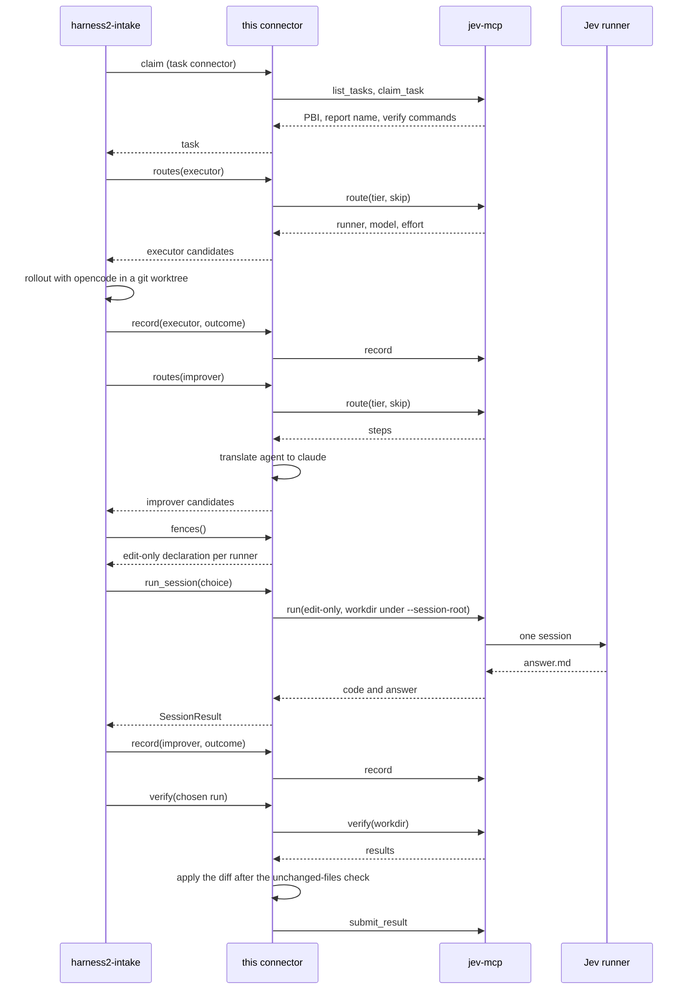

English | [日本語](README.ja.md)

# harness2-jev-connector

## Overview

harness2-jev-connector is a task connector for [harness2](https://github.com/reeschan/harness2)'s
`harness2-intake`. It claims the PBIs that are queued in jev-mcp. harness2 runs each PBI in a git
worktree for every rollout. The connector takes only the diff of the chosen run and applies it to the
source repository, after the source's untouched-files check (`docs/pbi/tools/unchanged.py`). It then
sends the verification results and the details back with `submit_result`.

The package also has a model connector, `jev`. harness2-intake loads it with `--model-connector jev`
and gets its model candidates, fence declarations and attempt records through the same jev-mcp.

<picture>
  <source media="(prefers-color-scheme: dark)" srcset="assets/architecture/architecture-dark.svg">
  
</picture>

The diagram source is `assets/architecture/architecture.d2`. Redraw it with the arch-diagram skill's `render.py`.

## Requirements

- POSIX: Linux or macOS. On Windows, use WSL.
- Python 3.12 to 3.13.
- harness2. The install below brings it in as a dependency.
- jev-mcp: the `jev_mcp.py` server that ships with the [Atelier](https://github.com/reeschan/atelier) skill (`skills/atelier/jev_mcp.py`; Atelier was called pbi-orchestration-jev, then Jev).

## Install

```sh
pip install "harness2-jev-connector @ git+https://github.com/reeschan/harness2-jev-connector.git"
```

harness2 is installed from git as a dependency, pinned to the commit this package is tested against (see `pyproject.toml`).

## Usage

Start jev-mcp over stdio:

```sh
python <path-to>/jev_mcp.py --root <repo> --root <work-root>
```

Or start it over HTTP:

```sh
python <path-to>/jev_mcp.py --http --port 7830 --root <repo> --root <work-root>
```

Then run harness2-intake against the HTTP endpoint:

```sh
harness2-intake --connector jev-mcp \
  --connector-opt url=http://127.0.0.1:7830/mcp \
  --repo <repo> --work-root <work-root>
```

Or let harness2-intake start jev-mcp itself over stdio:

```sh
harness2-intake --connector jev-mcp \
  --connector-opt command="python <path-to>/jev_mcp.py --root <repo> --root <work-root>" \
  --repo <repo> --work-root <work-root>
```

## Connector options

| Option | Default | Meaning |
| --- | --- | --- |
| `url` | none | URL of a jev-mcp HTTP endpoint, for example `http://127.0.0.1:7830/mcp`. Use it instead of `command`. |
| `command` | none | Command that starts jev-mcp over stdio, as a string or a list. A string is split with `shlex.split`. |
| `timeout` | 60 | Seconds to wait for one MCP call. A value from `--connector-opt` arrives as a string and is converted to a float. |
| `scrub_env` | `TYPESAFE_API_KEY` | Comma-separated names of the environment variables to remove from the agent's environment. Name the variables that hold secrets, for example `EXAMPLE_SECRET,ANOTHER_SECRET`. Pass a value to replace the default; an empty value removes nothing. |
| `pbi_dir` | `docs/pbi` | Directory in the repository that holds the PBI files. The connector keeps it out of the diff. |
| `runner` | `harness2` | Runner name that the connector records on a claim. |

harness2-intake supplies `repo`, `mode`, `locate` and `timeout` (its own `--timeout`, 3600 seconds
by default). A `--connector-opt` with the same name wins. `connector_from_options` uses 60 seconds
for `timeout` when the caller does not pass one.

## Model connector

The `jev` model connector gives harness2-intake its model candidates, fence declarations and
attempt records through the same jev-mcp as the task connector. Pass its options in
`--model-connector-opt`:

```sh
harness2-intake --model-connector jev \
  --model-connector-opt url=http://127.0.0.1:7830/mcp \
  --model-connector-opt repo=<repo> \
  --repo <repo> --work-root <work-root>
```

| Option | Default | Meaning |
| --- | --- | --- |
| `url` | none | URL of a jev-mcp HTTP endpoint, for example `http://127.0.0.1:7830/mcp`. Use it instead of `command`. |
| `command` | none | Command that starts jev-mcp over stdio, as a string or a list. A string is split with `shlex.split`. |
| `repo` | none | Path of the repository, required. jev-mcp answers about this repository. |
| `config` | see below | Path of the template file. The default place is used when the value is missing. |
| `template` | none | Name of the template to use for this run, in place of the file's `use`. |
| `timeout` | 60 | Seconds to wait for one MCP call. A value from `--model-connector-opt` arrives as a string and is converted to a float. |
| `isolate_opencode` | `true` | With `command`, points opencode's settings variables at an empty temporary directory. opencode's fence is declared only while this isolation holds. |

### How the pieces connect

harness2-intake drives a task from claim to submission, and it loads this package twice. The
task connector (`jev-mcp`) claims PBIs from jev-mcp and delivers the chosen run's diff. The
model connector (`jev`) is the source of the models and of the improver sessions.

Inside harness2-intake:

- **Executor choice.** Before a rollout it asks
  `routes("executor", task_id=..., substrate="opencode")` once and keeps the candidates for
  opencode. A candidate for another runner cannot run there and stays a skipped row. When
  opencode cannot use the current model, the rollout is tried once more, from the base
  worktree, with the next candidate.
- **Rollout.** For every rollout `WorktreeLauncher` makes a git worktree under `--work-root`,
  runs opencode there, and writes the diff to `workspace/output/changes.diff`. Paths under
  `docs/pbi` are left out of the diff, and the variables named by `scrub_env` (by default
  `TYPESAFE_API_KEY`, the one jev reads its API key from) are removed from the agent's
  environment.
- **Improver channel.** When the model connector has `run_session`, harness2 uses it for every
  improver session instead of its own channel. The session's working directory is made under
  `--session-root` (default `<work-root>/_sessions`).
- **Fence check.** harness2 compares each declaration from `fences()` with its ceiling for an
  improver session: file tools only, nothing outside the working directory, no human, no
  harness credentials. It skips a candidate whose runner has no declaration that meets the
  ceiling, and refuses to start when no runner does.

This connector sits between harness2-intake and jev-mcp and translates harness2's words into
Jev's words and back. jev-mcp is the server that keeps the queue and drives Jev: its task tools
are `list_tasks`, `claim_task`, `verify`, `submit_result` and `fail_task`, and its model tools
are `route`, `run` and `record`. The Jev runners this connector uses are `claude` (Claude Code,
headless) and `opencode`.

The repository and Jev's home are two different places. `docs/pbi` in the repository holds the
PBI files, the reports and the verification records; jev-mcp reads and writes them. Jev's home
holds its `routing.json`, templates and `agents.json`; Atelier finds it through `ATELIER_HOME`
(or the old `PBI_HOME`), else `$XDG_CONFIG_HOME/atelier`, falling back to the old
`$XDG_CONFIG_HOME/pbi-orchestration-jev` when only that one exists. The connector keeps
`docs/pbi` out of every diff and, when it isolates opencode, pins `ATELIER_HOME` so that
redirecting `XDG_CONFIG_HOME` does not move Atelier's home.

How harness2 itself calls a model connector — `routes`, `run_session`, `fences`, `record` and
what each must return — is in harness2's
[MODEL_CONNECTORS.md](https://github.com/reeschan/harness2/blob/main/docs/MODEL_CONNECTORS.md).

### One task, step by step



1. **Claim.** harness2-intake's task connector lists the queued PBIs with `list_tasks` and
   claims each one with `claim_task`. The claim carries the request, the PBI, the rework note,
   `worker.md` and the verification commands.
2. **Executor candidates.** harness2 calls `routes("executor", ...)`. For a Jev step the
   connector calls jev-mcp's `route` with the tier and a `skip` list (the runners the step does
   not want), and returns the runner, model and effort of each answer. harness2 keeps the
   opencode candidates.
3. **Rollout.** harness2 runs opencode with the current executor candidate in a worktree under
   `--work-root`. The worktree's diff is the deliverable; `docs/pbi` is excluded from it.
4. **Executor record.** harness2 hands the rollout's outcome to the connector's `record`, which
   calls jev-mcp's `record`. Jev writes one line in its `runs.jsonl`: `合格` when the attempt
   succeeded, `使えず` when the model could not be used, and `差し戻し` otherwise.
5. **Improver candidates.** harness2 calls `routes("improver", ...)`. A Jev step calls `route`
   again. In the improver role Jev's `agent` step (Claude Code's pbi-worker) becomes `claude`
   with the same model, run headless. A candidate is kept only when its runner has a declared
   fence and its setting is the one the step names.
6. **Fence.** harness2 reads `fences()` and ties each candidate to its declaration. It skips a
   candidate whose runner has no declaration; see [Fence translation](#fence-translation).
7. **Session.** harness2 picks a candidate and calls `run_session` with a working directory
   under `--session-root`; each candidate that is tried gets one session. The connector calls
   jev-mcp's `run` with that directory, the report, the runner, the model and the `edit-only`
   setting. jev-mcp starts the runner there. The session reads and writes and has no command
   tool. Its answer goes to `answer.md` in the working directory; `.last.md` is not written.
   The connector removes an older `answer.md` before it starts and returns this one's text.
8. **Improver record.** harness2 hands the result to `record` again. The outcome is `合格` when
   a usable answer came back, `使えず` when the choice was unavailable, and `差し戻し`
   otherwise.
9. **Verify.** After selection, the connector runs jev-mcp's `verify` on the chosen run's
   worktree with the PBI's verification commands. It gets the result entries, the number that
   passed and the total.
10. **Submit.** The connector applies the chosen run's diff to the source repository, after the
    source's untouched-files check (`docs/pbi/tools/unchanged.py`), and submits the status, the
    pass counts, the changed files, the unresolved items, the details and the artifacts with
    `submit_result`.

Known limitations:

- `record` takes the token counts and the cost from the repository's `docs/pbi/<runner>/` logs,
  which Jev reads. An improver session writes its logs in its own working directory, so those
  values can be empty or stale.
- When the attempt number is already taken, the connector calls `record` again once with the
  next number. If that number is taken too, the attempt is not recorded.
- The report name passed to `run` is the one from the last `routes` call. The connector expects
  harness2-intake to run tasks one at a time; do not use it from a caller that runs tasks in
  parallel.

### Setup

Install these:

- harness2. The install of this package brings it in as a dependency.
- this package, `harness2-jev-connector`.
- jev-mcp, the `jev_mcp.py` server that ships with the Atelier skill (`skills/atelier/jev_mcp.py`).
- Claude Code, for the `claude` runner.
- opencode, for the executor and for the `opencode` runner.

A stdio start lets the model connector isolate the jev-mcp it starts. It removes harness2's
credentials from the child's environment and points opencode's settings variables at an empty
directory, which is what makes opencode's fence declarable. The same environment keeps Jev's
home in place through `ATELIER_HOME`. Pass the same roots to the task connector:

```sh
harness2-intake --connector jev-mcp \
  --connector-opt command="python <path-to>/jev_mcp.py --root <repo> --root <work-root>" \
  --model-connector jev \
  --model-connector-opt command="python <path-to>/jev_mcp.py --root <repo> --root <work-root>" \
  --model-connector-opt repo=<repo> \
  --repo <repo> --work-root <work-root> --session-root <work-root>/_sessions
```

With HTTP, jev-mcp is a separate process whose environment the connector does not choose. Start
it yourself, without harness2's credentials, and give the same endpoint to both connectors:

```sh
harness2-intake --connector jev-mcp \
  --connector-opt url=http://127.0.0.1:7830/mcp \
  --model-connector jev \
  --model-connector-opt url=http://127.0.0.1:7830/mcp \
  --model-connector-opt repo=<repo> \
  --repo <repo> --work-root <work-root> --session-root <work-root>/_sessions
```

Over HTTP the connector cannot declare opencode; see [opencode isolation](#opencode-isolation).

Pass both `--repo` and `--work-root` to jev-mcp as `--root`, and keep `--session-root` under one
of those roots. The default session root is `<work-root>/_sessions`, which is already under
`--work-root`; `run` refuses a working directory outside every `--root`. The `--root` rule below
has the rest.

The template file holds the template to use and the steps of each role. The connector reads
`HARNESS2_JEV_MODELS` when it is set, else `$XDG_CONFIG_HOME/harness2-jev-connector/models.json`,
or `~/.config/harness2-jev-connector/models.json` when `XDG_CONFIG_HOME` is not set. `config=`
names another file.

```json
{
  "use": "claude-only",
  "templates": {
    "claude-only": {
      "executor": [{"jev": "haiku", "runners": ["opencode"]}],
      "improver": [{"runner": "claude", "model": "sonnet", "setting": "edit-only"}]
    },
    "cheap": {
      "executor": [{"jev": "haiku", "runners": ["opencode"]}],
      "improver": [
        {"runner": "claude", "model": "sonnet", "setting": "edit-only"},
        {"jev": "haiku", "runners": ["opencode"], "setting": "edit-only"}
      ]
    }
  }
}
```

`use` names the template a caller gets when it names none. A step is either a runner step
(`runner` and `model`, with optional `effort` and `setting`) or a Jev step (`jev` with a tier, and
optional `runners` and `setting`). An omitted `setting` is `default` for the executor and
`edit-only` for the improver; an improver step cannot say `default`, because that setting declares
no fence. `runners` keeps only those runners from Jev's answer; omit it to keep every runner. The
connector asks jev-mcp's `route` for a Jev step and turns the steps it returns into candidates.
For an improver, Jev's `agent` step (Claude Code's pbi-worker) becomes `claude` with the same
model, run headless. A role a template does not name uses that role's default: executor
`{"jev": "haiku"}`, improver `{"jev": "sonnet", "setting": "edit-only"}`. When the file is
missing, both defaults are used; with Jev's default routing, the default improver is `claude` with
`edit-only`.

`examples/models.json` holds two templates. `claude-only` is the default (`use`): its executor
asks Jev's haiku tier and keeps opencode, and its improver runs `claude` with `edit-only`. `cheap`
has the same executor and an improver that tries `claude` with `edit-only` first, then Jev's
haiku tier among opencode with `edit-only`. To use a template for one run only, pass
`--model-connector-opt template=cheap`.

### Fence translation

A Jev setting is not a harness2 fence; the connector translates it. This table is the whole
translation:

| Jev runner and setting | `capabilities` | `workdir_only` | `asks_human` | `harness_credentials` |
| --- | --- | --- | --- | --- |
| `claude`, `edit-only` | `read`, `write`, `search` | true | false | false |
| `opencode`, `edit-only` (stdio with the isolation) | `read`, `write`, `search` | true | false | false |

`edit-only` gives a session file tools only: it reads and writes and has no command tool. In
harness2's terms that is read, write and search; it works in its working directory only, asks no
human and gets no harness credentials. The connector declares the same fence for `claude` and
for `opencode`; the runner name is the only difference.

`default` is never declared. That setting has a command tool, so it cannot fit harness2's
ceiling for an improver session. A candidate whose runner and setting have no row here is
dropped from the improver routes, and a template that names `default` for an improver step is
rejected when the file is read.

The `claude` declaration assumes that jev-mcp runs without harness2's credentials. A stdio
start removes them from the child's environment. An HTTP jev-mcp passes its own startup
environment to the runner as it is, so start it in an environment without harness2's
credentials. `opencode` is declared only when the connector itself started jev-mcp over stdio
and the isolation holds; over HTTP it is not declared, because the connector cannot choose
jev-mcp's environment.

### opencode isolation

opencode reads the user's own settings and their MCP servers. To keep those out of an improver
session, the model connector isolates the jev-mcp child it starts over stdio. With
`isolate_opencode` (default `true`) and `command=`, the child's environment changes like this:

- `XDG_CONFIG_HOME` and `OPENCODE_CONFIG_DIR` point at an empty temporary directory. The
  connector makes it and removes it on `close`.
- `OPENCODE_CONFIG_CONTENT` and `OPENCODE_PERMISSION` are removed from the child's environment.
- `ATELIER_HOME` is pinned to the Atelier home the user's environment points at:
  `$XDG_CONFIG_HOME/atelier` (else `~/.config/atelier`), or the old `pbi-orchestration-jev`
  folder there when only that one exists. When `ATELIER_HOME`, `PBI_HOME` or
  `PBI_TEMPLATES_HOME` is already set, nothing is pinned.
- harness2's credentials are removed: the `HARNESS2_*` variables whose names end in `_KEY`,
  `_TOKEN` or `_SECRET`, plus `GOOGLE_APPLICATION_CREDENTIALS`, `GOOGLE_CLOUD_PROJECT` and
  `HARNESS2_VERTEX_PROJECT`.

opencode's authentication and provider definitions usually live under `XDG_DATA_HOME`, which
stays. Provide them there or through environment variables, because the user's config directory
is not read any more.

The isolation does not close every place opencode reads. opencode may also read `~/.opencode`,
and a project's `opencode.json` or `.opencode/` from the session directory up to the root of its
git work tree. List opencode as an improver in a template only for an environment where those
files and directories are absent, and keep `--session-root` outside any git work tree.

Over HTTP the connector cannot choose jev-mcp's environment, so it does not declare opencode.
Starting that jev-mcp with an isolated environment does not change that.

### Troubleshooting

**No candidates.** The connector warns
`route for <report> (tier <tier>) gave no candidates: ...` when jev-mcp's `route` fails. Check
the jev-mcp log for that error. A `route` also gives nothing when the PBI's
`docs/pbi/<report>.facts.json` is missing, or when the template's executor step keeps no
opencode runner (its `runners` list has no `opencode`). harness2 then stops with
`no executor model for substrate opencode`.

**harness2-intake exits 2 at start-up.** Exit 2 is an argument error, and one of them is a model
connector with `run_session` and no runner whose fence meets the requirements. The error line
names each runner and its problems. Check the template's improver steps and settings: an
improver step can only be `edit-only`, and opencode is declared only for a stdio start with the
isolation on.

**`run` is refused outside `--root`.** jev-mcp's `run` accepts a working directory only under
one of its `--root` options. Put `--session-root` under `--root`; the default
`<work-root>/_sessions` is under `--work-root`, so pass `--work-root` as a `--root` too.

**The same failure keeps coming back.** A `使えず` outcome moves on to the next candidate; when
every candidate is unusable the attempt ends with `no fenced improver model: ...`. Jev's
`runners.md` has a section "使えないとき" on what to check for each runner.

**opencode is never used over HTTP.** The connector cannot choose an HTTP jev-mcp's
environment, so it does not declare opencode's fence. Use a stdio start (`command=`) when an
opencode improver is wanted.

## Replaying Atelier's cases

Atelier's `export_cases.py` writes one normalized case per judged PBI to `docs/pbi/cases.jsonl`
(and next to `runs.jsonl` in its archive). The task connector `atelier-cases` replays them, so
harness2 can refine Atelier's own instructions on the PBIs that were sent back. Each element of
a case goes to one harness2 component:

| Case | harness2 |
| --- | --- |
| `harness.system_prompt` (worker.md) | `systemprompt.md` of the starting harness (`base_harness()`) |
| `harness.guardrails` (the CLAUDE.md files that applied) | `guardrails.md`, read from the repository; a file whose version changed is noted, one over the always-on cap is left out |
| `harness.memory` (refs) | the Refs section of the task's prompt, with each gist |
| `task` (the PBI's sections) | the task's prompt |
| `task.verify`, `task.acceptance`, `private.rework` | private criteria; only the judge reads them |

A case is taken up only when its `base_commit` is the HEAD of `--repo`, it was sent back (unless
`include=all`), it has no `depends_on` (unless `dependent=true`), and its worker version is the
one chosen (`worker`, else the newest). Run the replay in a worktree of the base commit:

```sh
git -C <repo> worktree add <replay-dir> <base_commit>
harness2-intake --connector atelier-cases \
  --connector-opt cases=<path>/cases.jsonl \
  --repo <replay-dir> --work-root <work-root>
```

Nothing goes back to the source: `deliver` writes `<out>/<task id>.json` (status, the chosen run's
summary and adopted harness) and `<out>/<task id>.diff`. `out` defaults to `replay/` next to the
first cases file. The judge runs the `verify <n>` criteria in the chosen run's worktree and counts
those that exit 0.

| Option | Default | Meaning |
| --- | --- | --- |
| `cases` | required | A `cases.jsonl` path, or several separated by commas |
| `out` | `replay/` next to the first file | Where the results go |
| `include` | `sent-back` | `sent-back` or `all` |
| `worker` | the newest | The worker.md version (12 hex characters) to replay |
| `dependent` | `false` | Also take cases with `depends_on` |

Compare the adopted harness (`harness_dir` in the result) with worker.md and the CLAUDE.md files to
decide what to change in Atelier; a person makes that change in a pull request.

## Rework report

`atelier-rework-report` reads Atelier's `runs.jsonl` (or every one in the archive with
`--archive`) and prints the first-pass rate, the rework rate and the stop rate; the causes of
rework (`spec`, `convention`, `scope` and `memory` on the instruction side, `model`, `env`); how
often shared memory was misused, listed refs were not read and "Do not touch" files changed; the
same rates per worker.md version and per first model; and the latest rows with an
instruction-side cause, which are the candidates to replay. `--json` prints the same as JSON.

It also shows time and tokens: per PBI, the seconds, steps and tokens of every attempt added
up (unusable and reworked ones included), as medians per worker.md version, per first model and
per first tier, with the share of tokens lost to reworks and unusable attempts and the share of
input read from the cache. When a `cases.jsonl` from Atelier's `export_cases.py` sits next to a
`runs.jsonl`, the PBIs are also split by the number of Targets, the number of refs and the
length of the text the worker was given, and the heaviest PBIs are listed with their size. A
large PBI that was sent back is a candidate to split; a long text with a first pass is a
candidate to trim from the always-on instructions or the refs.

```sh
atelier-rework-report --archive
```

## The `--root` rule

jev-mcp's `verify` requires the working directory to be under one of its `--root` options. A
rollout's worktree is created under `--work-root`, so pass both `--repo` and `--work-root` as
`--root`. Keep `--work-root` outside the work tree of `--repo`; harness2-intake checks this.

## What the connector provides

- `workspace_policy`: keeps `docs/pbi` out of the diff.
- `scrub_env`: removes the named variables from the agent's environment. By default it removes
  `TYPESAFE_API_KEY`, the variable jev reads its API key from; only jev-mcp needs it.
- `judge()`: runs `verify` on a run and returns `n_passed`, `n_criteria` and `all_pass`. Selection
  does not use it.
- `report(task_id)`: the five-line report that jev-mcp wrote for the task.
- `close()`: closes the MCP client.
- If the connection drops while claiming, the connector fails the tasks that it has already claimed
  with `fail_task`, then stops.
- model connector (`jev`, the `jev` entry point): turns a template into the candidate models of
  each role, declares the fence of each improver runner, runs improver sessions with jev-mcp's
  `run`, and records every attempt with jev-mcp's `record`.

## Development

Run these in WSL:

```sh
uv run --python 3.12 python -m unittest discover -s tests
uvx ruff@0.17.1 check .
uvx ruff@0.17.1 format --check .
```

## License

Apache-2.0. Some code is moved from harness2 (Apache-2.0, Copyright 2026 Google LLC). Each such
file says so at the top.
